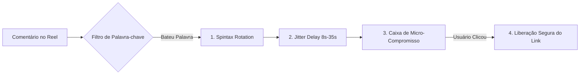

# 🛡️ REA: Engenharia Anti-Bloqueio para Instagram (Comentários & DM)

> **Manual de Imunidade a Bloqueios do Instagram**  
> *Mapeamento Forense dos Algoritmos de Detecção da Meta (2026)*

---

## 1. Por que o Instagram Bloqueia Ferramentas Amadoras?

A Meta utiliza três redes neurais principais de moderação no Instagram Direct:
1. **Hash & Exact Match Detector:** Detecta se a mesma string exata de texto ou o mesmo link está sendo disparado para dezenas de usuários em curto período.
2. **Velocity & Burst Anomaly Detector:** Analisa a frequência de respostas. Se 50 pessoas comentam e 50 DMs são disparadas em 3 segundos, o IP/conta é sinalizado como automação não humana.
3. **Unsolicited Link Flagging:** Se uma conta envia um link com domínio externo na primeiríssima mensagem privada para alguém que ainda não clicou em nada na conversa, a mensagem cai na caixa de "Solicitações Ocultas" ou a conta recebe bloqueio temporário de 24h a 7 dias.

---

## 2. As 4 Camadas de Proteção Implementadas no WebFlow



### 🎯 Camada 1: Rotação Dinâmica de Comentários Públicos (Spintax)
Nunca responda ao comentário do Reel com a mesma frase. O WebFlow implementa um motor de **Spintax com 8 variações randômicas**:
- `"{Opa|Ei|Olá} @username, {acabei de te enviar|mandei no seu Direct|dá uma olhadinha no seu direct}!"`
- `"{Tudo certo|Beleza} @username? {Te respondi no privado|Já te mandei lá no direct}! 🚀"`
- `"{Fala|Show} @username! {Dá um pulo no seu Direct|O link acabou de chegar no seu direct}."`

> 🔑 **Efeito Meta:** A Meta enxerga centenas de respostas públicas diferentes, eliminando a detecção por padrão repetitivo.

---

### ⏱️ Camada 2: Atraso Randômico Humanizado (Jitter Delay)
- **O Erro Amador:** Responder em 0.5s após o comentário.
- **O Padrão WebFlow:** Aplicar um delay aleatório de **8 a 35 segundos**.
- Além disso, limitar a taxa de disparo a no máximo **10 DMs por minuto**, enfileirando os comentários excedentes.

---

### 📦 Camada 3: O Botão de Confirmação (Micro-Compromisso)
Quando o robô abre o Direct, ele **NUNCA** envia a URL de cara. Ele envia:

```
[ Mensagem no Direct ]
"Oi! Vi seu comentário no vídeo pedindo o material.
Para eu ter certeza que você não é um robô e te enviar o acesso correto,
toque no botão abaixo:"

[ Botão: Liberar Meu Acesso ]
```

**O que acontece quando a pessoa clica:**
1. A Meta interpreta o clique no botão como um evento `postback`.
2. O evento `postback` qualifica a conversa como **ativa e consentida**.
3. O Direct não joga a mensagem no lixo e não bloqueia a sua conta.

---

### 🛑 Camada 4: Respeito Estrito à Janela de 24 Horas
- O WebFlow conta regressivamente as 24h a partir do último envio do lead.
- Quando o contador zera, o sistema **bloqueia automaticamente** o envio de fluxos com links, exibindo um aviso visual no CRM:  
  `⚠️ Janela de 24h expirada. Aguarde o usuário enviar uma nova mensagem para reabrir a janela.`

---

## 3. Checklist Definitivo Pré-Lançamento

- [x] Spintax ativado com pelo menos 6 frases distintas.
- [x] Jitter ativado (atraso mínimo de 8 segundos).
- [x] Primeira mensagem sem nenhum link `http/https`.
- [x] Botão interativo (*Quick Reply* ou *Generic Template*) configurado.
- [x] Limite horário respeitado (menos de 500 DMs/hora por conta).
- [x] Botão de "Human Takeover" habilitado no painel para pausar o robô caso o cliente peça para falar com uma pessoa real.
