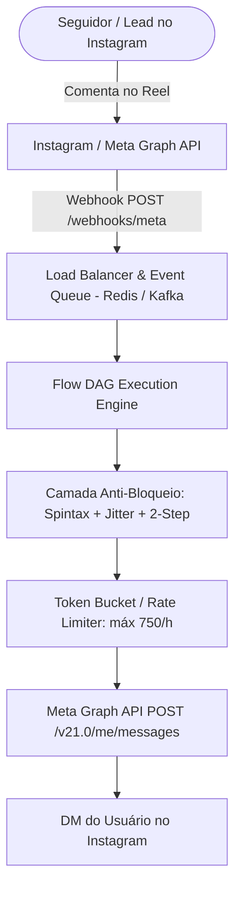

# 🔬 Reverse Engineering Analysis (REA): Arquitetura Interna do ManyChat

> **Documento Oficial de Engenharia Reversa**  
> *Versão:* 2.0 (2026) — Meta Graph API v21.0 / ManyChat Dynamic Blocks v2  
> *Objetivo:* Mapear com precisão cirúrgica a arquitetura, protocolos e mecanismos de execução do ManyChat para replicação 100% gratuita no **WebFlow**.

---

## 1. O que é o ManyChat por Debaixo dos Panos?

O ManyChat não é um serviço mágico de inteligência artificial autônomo; ele é essencialmente um **Orquestrador de Webhooks de Alta Vazão** operando sobre a **Meta Graph API** (Instagram Graph API, Messenger Platform e WhatsApp Cloud API).



---

## 2. Componentes Fundamentais da Arquitetura

### 2.1. O DAG Flow Builder (Directed Acyclic Graph)
Toda automação no ManyChat é serializada como um grafo direcionado acíclico (DAG):
- **Nodes (Nós):**
  - `trigger`: Início do fluxo (ex: comentário em Reel com palavra-chave, DM recebida, clique em anúncio).
  - `send_message`: Envio de balão de texto, imagem, carrossel, áudio ou vídeo.
  - `interactive_box`: Envio de botões rápidos (*Quick Replies*) ou botões genéricos (*Generic Template*).
  - `condition`: Bifurcação lógica baseada em variáveis (`tag_contains`, `field_equals`, `24h_window_active`).
  - `smart_delay`: Pausa intencional de 8 segundos a 24 horas.
  - `action`: Adição de tags, atualização de campos customizados, notificação do atendente humano ou disparo de webhook externo.
- **Edges (Arestas):** Conexões direcionadas entre nós com suporte a saídas condicionais (`success`, `timeout`, `clicked_button_1`).

### 2.2. O Modelo de Dados do Contato (Unified Profile)
Cada contato é identificado univocamente por seu `IGSID` (Instagram Scoped ID) ou `PSID` (Page Scoped ID):
```json
{
  "id": "ct_98721401",
  "igsid": "17841400234567890",
  "username": "joaovitor_marketing",
  "name": "João Vitor",
  "status": "lead",
  "last_interaction_at": "2026-10-13T15:24:10Z",
  "window_expires_at": "2026-10-14T15:24:10Z",
  "bot_paused": false,
  "human_takeover_until": null,
  "tags": ["interessado_mentoria", "comentou_reel_10"],
  "custom_fields": {
    "email": "joao@email.com",
    "faturamento": "50k_100k"
  }
}
```

---

## 3. As 3 Regras de Ouro da Meta (Sem as quais você é banido)

### Regra 1: Janela de Mensagens de 24 Horas (*Messaging Window*)
- **O que é:** Quando um usuário interage ativamente com seu perfil (comenta, envia DM ou clica em botão), a Meta abre uma **janela estrita de 24 horas**.
- **Durante as 24h:** Você pode enviar mensagens promocionais, links e fluxos livremente.
- **Após as 24h:** É **estritamente proibido** enviar mensagens promocionais ou links. Apenas mensagens com `Message Tags` autorizadas (como `CONFIRMED_EVENT_UPDATE`, `PURCHASE_UPDATE`) podem ser enviadas, e links resultam em suspensão imediata da conta do Instagram.

### Regra 2: Resposta a Comentários (*Private Replies*)
- A Meta permite responder a um comentário de publicação enviando 1 DM privada usando o parâmetro `recipient.comment_id`.
- **Limite rígido da Meta:** Máximo de **750 Private Replies por hora por conta**. Ultrapassar esse volume aciona o mecanismo de *Spam Velocity Detection* do Instagram.

### Regra 3: Política de Links Externos
- A Meta penaliza perfis que disparam links externos na primeiríssima mensagem logo após um comentário.
- **Solução ManyChat:** Técnica da "Caixinha de Confirmação" (Micro-compromisso em 2 etapas).

---

## 4. O Segredo do "Micro-Compromisso" (2-Step Button)

O ManyChat NUNCA envia o link direto na primeira mensagem quando a pessoa comenta "EU QUERO". Ele executa o seguinte protocolo:

1. **Passo 1 (Primeira DM):**  
   "Ei! Vi seu comentário no Reel. Para confirmar que você é uma pessoa real e liberar o acesso, clique no botão abaixo:"  
   *(Botão interativo: `[ Quero Acessar Agora ]`)*
2. **Passo 2 (Clique do Usuário):**  
   Quando o usuário clica no botão, a Meta registra uma **interação voluntária ativa**.
3. **Passo 3 (Segunda DM):**  
   "Perfeito! Aqui está o seu link exclusivo: `https://seusite.com/conteudo`".

> 💡 **Por que isso é revolucionário?**  
> Ao clicar no botão, o usuário zera a janela de 24 horas, demonstra consentimento explícito e o algoritmo do Instagram classifica o chat como uma conversa amigável legítima, e não como disparo de robô de spam!

---

## 5. Matriz de Equivalência: ManyChat Pro vs WebFlow

| Recurso | ManyChat Pro | WebFlow (Open-Source) |
| :--- | :---: | :---: |
| **Custo Mensal** | $15 a $145+/mês | **R$ 0,00 (100% Gratuito Para Sempre)** |
| **Limite de Contatos** | Pago por faixa de leads | **Ilimitado (seu banco de dados)** |
| **Visual Flow Builder** | Sim (Proprietário) | **Sim (DAG Canvas Interativo)** |
| **Growth Tool: Comentários em Reels** | Sim | **Sim (Com Spintax de 8 variações)** |
| **Jitter Humanizado de Envio** | Básico | **Sim (Atraso randômico 8s a 35s)** |
| **Micro-Compromisso 2-Step** | Sim | **Sim (Caixa interativa nativa)** |
| **CRM e Live Chat com Human Takeover** | Sim | **Sim (Pausa de bot em 1 clique)** |
| **Hospedagem** | Servidores ManyChat | **Cloudflare Pages + Supabase Gratuito** |
| **Privacidade dos Leads** | Compartilhado com ManyChat | **100% Seu (Armazenado no seu PostgreSQL)** |
